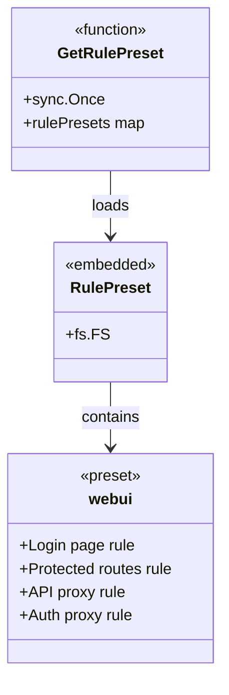
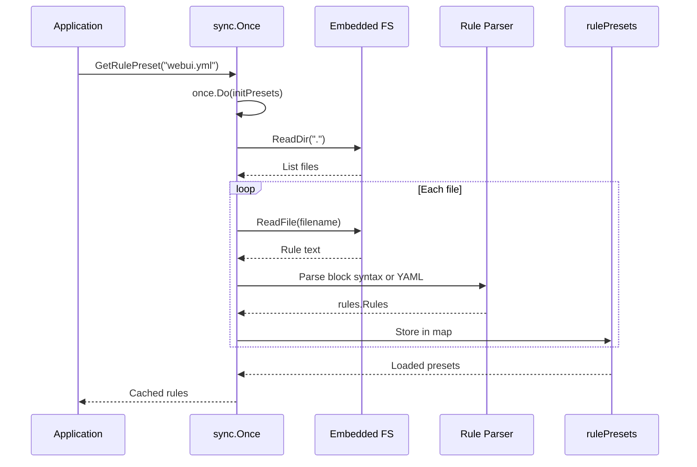

# internal/route/rules/presets

Provides embedded, pre-configured rule sets for common routing patterns.

## Overview

The `internal/route/rules/presets` package provides embedded rule configurations that can be reused across routes. Presets are compiled into the binary and loaded at runtime via `sync.Once` initialization.

### Primary Consumers

- **Route configuration**: Applies preset rules to routes
- **WebUI**: Provides default rules for web applications
- **API gateway**: Common patterns for API routes

### Non-goals

- Does not modify presets at runtime
- Does not provide dynamic preset loading
- Does not support preset inheritance/overriding

### Stability

Internal package. Preset content is stable but may change between versions.

## Public API

### Exported Functions

```go
// GetRulePreset retrieves a preset by name
func GetRulePreset(name string) (rules.Rules, bool)
```

**Contract:**

- Uses `sync.Once` for one-time initialization
- Looks up the complete filename, including `.yml`
- Returns the cached rule slice; callers must treat it as read-only
- Second return value indicates if preset exists

## Architecture

### Core Components



### Preset Loading Flow



## Preset Files

### Directory Structure

```
internal/route/rules/presets/
├── embed.go          //go:embed *.yml
├── webui.yml         // WebUI preset
└── README.md
```

### webui Preset

The default preset for GoDoxy WebUI. Preset files use the route-rules block syntax (YAML remains supported by the parser, but built-in presets should prefer block syntax):

**What it does:**

1. Allows unauthenticated access to `/login`
1. Requires auth for most app paths, excluding static assets, public metadata, and auth endpoints
1. Dispatches `/api/v1/*` to the in-process GoDoxy API handler
1. Rewrites `/auth/*` and dispatches it to the in-process auth API handler

## Dependency and Integration Map

| Dependency               | Purpose                         |
| ------------------------ | ------------------------------- |
| `internal/route/rules`   | Rules engine for preset content |
| `internal/serialization` | Converts embedded preset text into `rules.Rules` |
| `sync`                   | One-time initialization         |

## Observability

### Logs

- DEBUG: Successfully loaded preset filenames
- ERROR: Embedded file reads and rule parsing failures
- Unknown preset names return `false`; the caller decides how to report them.

## Security Considerations

- Presets are compiled into binary (immutable at runtime)
- Environment variable substitution (`${VAR}`) supports secure configuration
- No runtime preset modification possible

## Failure Modes and Recovery

| Failure             | Behavior             | Recovery              |
| ------------------- | -------------------- | --------------------- |
| Preset file missing | Returns (nil, false) | Check preset exists   |
| Preset parse error  | Preset is skipped and an error is logged | Fix preset block syntax |
| Unknown preset name | Returns (nil, false) | Use valid preset name |

## Usage Examples

### Loading a Preset

```go
import rulepresets "github.com/yusing/godoxy/internal/route/rules/presets"

rules, ok := rulepresets.GetRulePreset("webui.yml")
if !ok {
    return fmt.Errorf("preset not found")
}

// Apply rules to a handler
handler := rules.BuildHandler(upstreamHandler)
```

### Creating a Custom Preset

```bash
# internal/route/rules/presets/api-gateway.yml
method OPTIONS {
  set resp_header Access-Control-Allow-Origin *
  set resp_header Access-Control-Allow-Methods "GET, POST, PUT, DELETE, OPTIONS"
}

method OPTIONS {
  error 204 ""
}

!path /health {
  require_auth
}
```

Rebuild GoDoxy to embed the new `.yml` file, then load it by filename:

```go
rules, ok := rulepresets.GetRulePreset("api-gateway.yml")
```

### Using Preset in Route Config

```yaml
webapp:
  scheme: http
  host: localhost
  port: 3000
  rule_file: embed://webui.yml
```

`rule_file` and inline `rules` are mutually exclusive. There is no `include`
action. To customize a preset, copy its rules into a separate rule file and use
`rule_file: /path/to/custom.rules`, or put the combined rules in `rules: |`.

## Limitations

- Presets are read-only after initialization
- No runtime preset modification
- All presets loaded at first access (no lazy loading)
- No preset merging (caller must handle)
